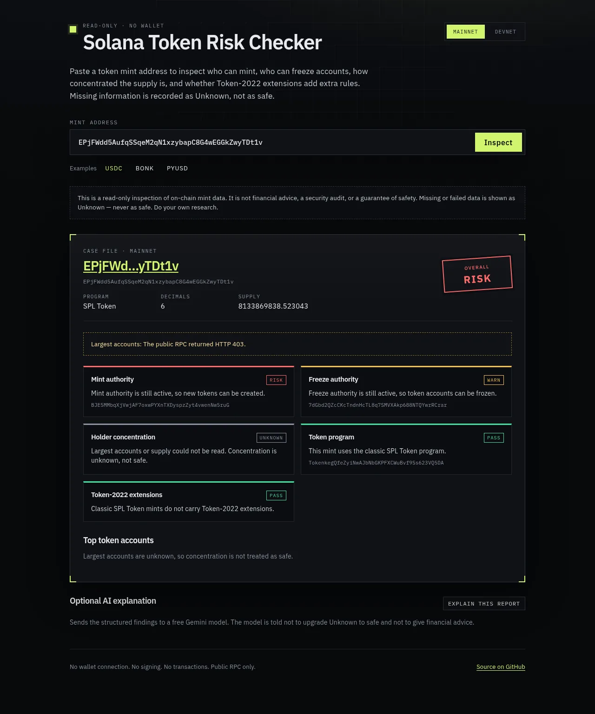

# Solana Token Risk Checker

Paste a Solana token mint address and inspect, in one report, who can still mint, who can freeze accounts, how concentrated the supply is, and whether Token-2022 extensions add extra rules.

**Live demo:** https://solana-token-risk-checker.vercel.app

This is a read-only tool. There is no wallet connection, no signing and no transactions. Missing or failed data is shown as **Unknown**, never as safe.



## Why it exists

A mint address is not a safety rating. Classic red flags for a token still hide in ordinary on-chain fields: an active mint authority, an active freeze authority, a supply that sits in a handful of accounts, or Token-2022 extensions such as a permanent delegate or a transfer hook. This app surfaces those fields and refuses to treat a gap in the data as a pass. The principle is simple: **missing information means unknown, not safe**.

The report is not financial advice, a security audit, or a guarantee that a token is safe to use.

## What is checked

Each check is rated **Pass**, **Warn**, **Risk** or **Unknown**. The overall rating is the most severe of the individual checks, with Risk above Warn, Warn above Unknown, and Pass only if every check passed.

| Check | Pass | Warn | Risk | Unknown |
|---|---|---|---|---|
| Mint authority | Authority revoked | — | An authority can still mint new tokens | The field could not be read |
| Freeze authority | Authority revoked | An authority can still freeze accounts | — | The field could not be read |
| Holder concentration | Top account &lt; 20% and top 10 &lt; 70% | Top account ≥ 20% or top 10 ≥ 70% | Top account ≥ 50% or top 10 ≥ 90% | Supply or largest accounts could not be read, or supply is zero |
| Token program | Classic SPL Token | Token-2022 (extra rules may apply) | — | The program could not be identified |
| Token-2022 extensions | No warning- or risk-level extensions | Fees, pausable-adjacent metadata, confidential balances, and similar | Permanent delegate, transfer hook, default frozen state, or a paused mint | Extensions could not be parsed |

Supply and decimals are shown as facts. They do not get a rating of their own.

The app talks to the public mainnet RPC at `https://api.mainnet-beta.solana.com`, with `https://solana-rpc.publicnode.com` as a fallback. A toggle switches the lookup to devnet (`https://api.devnet.solana.com`). Requests are retried on HTTP 429 and other transient errors. Invalid addresses are rejected before any RPC call is made.

Ready-made examples include USDC and BONK (classic SPL) and PYUSD (Token-2022).

## Optional AI explanation

The **Explain this report** button sends the structured findings, not a free-form prompt, to a free Gemini model through a Vercel serverless function. The model is instructed not to upgrade an Unknown rating to safe and not to give financial advice. The API key lives only in Vercel environment variables and is never committed. Requests are rate-limited and the payload is capped.

## Tech stack

- [Vite](https://vite.dev) + [React](https://react.dev) + TypeScript
- [`@solana/web3.js`](https://github.com/solana-labs/solana-web3.js) for official program IDs and JSON-RPC calls
- Vitest unit tests (address validation, scoring, Unknown handling, HTTP rate limits)
- GitHub Actions CI (type check, tests, build) with no secrets
- Deployed on [Vercel](https://vercel.com) (deploys on every push to `main`)

## Running it yourself

Requires Node.js 20.9+.

```bash
npm install
npm test
npm run dev
```

The Vite dev server also serves `/api/inspect` and `/api/explain`. To try the optional explanation locally, copy `.env.example` to `.env` and set `GOOGLE_GENERATIVE_AI_API_KEY`. Leave it unset if you only want the on-chain report.

## License

[MIT](LICENSE)
